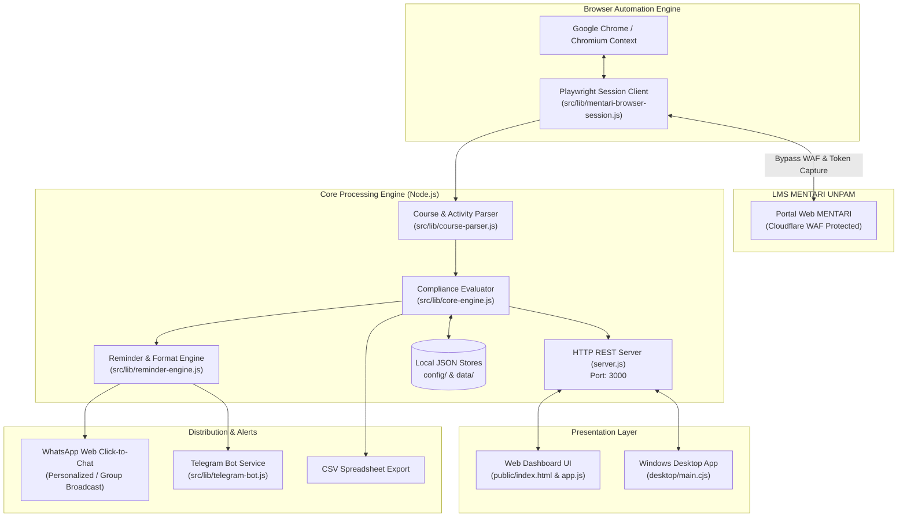

# TugasKu

<div align="center">

[](CHANGELOG.md)
[](https://nodejs.org)
[](https://github.com)
[](https://playwright.dev)
[-success.svg?style=for-the-badge&logo=checkmarx&logoColor=white)](test/run-all-tests.js)
[](LICENSE)

**Sistem Otomasi dan Pemantauan Tugas Akademik LMS MENTARI Universitas Pamulang (UNPAM)**  
*Membantu ketua kelas dan mahasiswa memantau kepatuhan tugas, absensi, serta rekapitulasi pengingat grup secara lokal dan otomatis.*

[Fitur Utama](#fitur-utama) •
[Arsitektur](#arsitektur-sistem) •
[Instalasi](#panduan-instalasi--penggunaan) •
[Konfigurasi](#konfigurasi-lingkungan) •
[CLI Reference](#referensi-perintah-cli) •
[Dokumentasi](#dokumentasi-terkait)

</div>

---

## Daftar Isi

- [Tentang Proyek](#tentang-proyek)
- [Fitur Utama](#fitur-utama)
- [Arsitektur Sistem](#arsitektur-sistem)
- [Struktur Repositori](#struktur-repositori)
- [Prasyarat Sistem](#prasyarat-sistem)
- [Panduan Instalasi & Penggunaan](#panduan-instalasi--penggunaan)
  - [Opsi A: Aplikasi Desktop Windows (.exe)](#opsi-a-aplikasi-desktop-windows-exe---rekomendasi)
  - [Opsi B: Shortcut Cepat Desktop](#opsi-b-shortcut-cepat-desktop-windows)
  - [Opsi C: Mode Pengembangan Web / Server Lokal](#opsi-c-mode-pengembangan-web--server-lokal)
- [Konfigurasi Lingkungan](#konfigurasi-lingkungan)
- [Referensi Perintah CLI](#referensi-perintah-cli)
- [Pengujian Unit (Quality Assurance)](#pengujian-unit-quality-assurance)
- [Keamanan & Privasi Data](#keamanan--privasi-data)
- [Dokumentasi Terkait](#dokumentasi-terkait)
- [Lisensi & Kontribusi](#lisensi--kontribusi)

---

## Tentang Proyek

Pada perkuliahan berbasis LMS MENTARI di Universitas Pamulang, mahasiswa diwajibkan menyelesaikan aktivitas terstruktur di setiap pertemuan perkuliahan, meliputi:
1. **Posttest / Kuis** sebagai bukti evaluasi pembelajaran.
2. **Forum Diskusi** dengan batas minimal balasan (*reply*) untuk validasi kehadiran.
3. **Kuesioner Pembelajaran** untuk pengesahan absensi semester.

Memeriksa status pengerjaan puluhan mahasiswa secara manual di setiap mata kuliah sangat menyita waktu dan rentan kekeliruan. **TugasKu** hadir sebagai solusi otomasi lokal yang aman, menghubungkan sesi MENTARI dengan generator rekapitulasi pesan instan (WhatsApp & Telegram), tanpa mengirim data pribadi ke server eksternal mana pun.

---

## Fitur Utama

- **Otomasi Login & Bypass WAF Cloudflare**:
  Menggunakan browser Google Chrome / Chromium lokal melalui Playwright dengan *persistent context*, menangkap token sesi MENTARI secara aman tanpa risiko pemblokiran IP oleh Cloudflare WAF.
- **Pemantauan Kepatuhan Real-Time**:
  - Rekap mahasiswa yang belum mengerjakan Posttest.
  - Analisis kepatuhan Forum Diskusi (mendeteksi multi-topik diskusi dan kuantitas balasan per mahasiswa).
  - Validasi pengisian Kuesioner pembelajaran dosen.
  - Klasifikasi moda perkuliahan (Daring, Luring, atau Tugas Mandiri).
- **Generator Draf Pesan WhatsApp Pintar**:
  - Teks pengingat siap salin atau langsung kirim via WhatsApp Web (*Click-to-Chat*).
  - Sakelar fleksibel: Penyamaran nomor HP untuk melindungi privasi mahasiswa serta opsi format penomoran (angka vs bullet point).
- **Integrasi Bot Telegram & Scheduler**:
  - Perintah bot interaktif (`/rekap`, `/status`, `/jadwal`) untuk memantau dari smartphone.
  - Scheduler cron di latar belakang untuk notifikasi otomatis menjelang tenggat waktu (*deadline*).
- **Aplikasi Desktop Mandiri (Windows)**:
  - Tersedia dalam format **NSIS Installer** resmi (dengan shortcut Desktop dan uninstaller) serta format **Portable** (tanpa instalasi).
  - Isolasi data pengguna di folder `%APPDATA%/TugasKu` agar konfigurasi tidak hilang saat aplikasi diperbarui.
- **Ekspor Data & Distribusi Bersih**:
  - Ekspor tabel rekap ke format CSV (kompatibel Excel & Google Sheets).
  - Skrip `npm run export:clean` yang menyaring dan membersihkan seluruh kredensial rahasia sebelum paket dibagikan ke mahasiswa lain.

---

## Arsitektur Sistem

Alur kerja arsitektur sistem TugasKu dirancang secara modular dan berorientasi lokal:



---

## Struktur Repositori

```text
TugasKu/
├── .github/                     # Konfigurasi GitHub Actions & Templates
│   ├── workflows/ci.yml         # Automated CI test workflow (Node 18/20/22)
│   ├── ISSUE_TEMPLATE/          # Template laporan bug dan usulan fitur
│   └── PULL_REQUEST_TEMPLATE.md # Standar template Pull Request
├── config/                      # Konfigurasi kelas, jadwal, dan contoh template
│   ├── class-settings.json      # Pengaturan kelas aktif & mode perkuliahan
│   ├── courses.json             # Daftar mata kuliah terdaftar
│   ├── schedule.json            # Jadwal perkuliahan mingguan
│   ├── contacts.example.json    # Template daftar kontak mahasiswa
│   ├── session.example.json     # Template penampung sesi login MENTARI
│   └── telegram.example.json    # Template konfigurasi bot Telegram
├── desktop/                     # Lapisan aplikasi Desktop (Electron)
│   ├── main.cjs                 # Proses utama Electron & child process backend
│   ├── icon.ico                 # Ikon resmi aplikasi Windows
│   └── icon.png                 # Aset ikon PNG resolusi tinggi
├── docs/                        # Dokumentasi spesifikasi arsitektur & API
│   ├── FIGMA_UI_UX_DESIGN_SPEC.md
│   ├── MENTARI_API_CONTRACT.md
│   ├── TUGASKU_SPEC.md
│   └── WHATSAPP_INTEGRATION_DESIGN.md
├── public/                      # Antarmuka Web Dashboard lokal
│   ├── index.html               # Struktur halaman dashboard
│   ├── app.js                   # Logika interaktif antarmuka & auto-scan
│   ├── style.css                # Kustomisasi gaya visual
│   ├── tailwind.min.js          # Library styling responsif
│   └── icon.png                 # Favicon web
├── src/                         # Sumber kode inti (Core Modules)
│   ├── lib/                     # Modul logika bisnis, parser, & engine
│   │   ├── core-engine.js       # Evaluator kepatuhan tugas mahasiswa
│   │   ├── course-parser.js     # Parser data materi & forum MENTARI
│   │   ├── mentari-browser-session.js # Browser persistent context Playwright
│   │   ├── telegram-bot.js      # Layanan interaksi bot Telegram
│   │   ├── reminder-engine.js   # Generator pesan rekapitulasi tugas
│   │   └── storage/             # Pengelola penyimpanan berkas JSON lokal
│   └── scripts/                 # Utilitas otomasi build & export
│       ├── export-clean.js      # Pembuat paket distribusi arsip bersih
│       └── generate-icon.js     # Generator ikon aplikasi dari SVG
├── test/                        # Rangkaian pengujian unit & integrasi
│   ├── run-all-tests.js         # Test suite runner utama
│   └── *.test.js                # 18 berkas skenario pengujian modular
├── .env.example                 # Template variabel lingkungan
├── .gitignore                   # Aturan pengecualian berkas rahasia & build
├── CHANGELOG.md                 # Catatan riwayat versi (Keep a Changelog)
├── CODE_OF_CONDUCT.md           # Pedoman perilaku komunitas kontributor
├── CONTRIBUTING.md              # Panduan tata cara kontribusi kode
├── LICENSE                      # Lisensi resmi (MIT)
├── package.json                 # Metadata proyek & skrip eksekusi
├── pipeline.js                  # Skrip runner pipeline eksekusi CLI
├── scan.js                      # Skrip pemindaian MENTARI via CLI
├── scheduler.js                 # Skrip runner scheduler latar belakang
├── server.js                    # Server HTTP REST backend utama
├── SECURITY.md                  # Kebijakan pelaporan kerentanan keamanan
└── start-tugasku.bat            # Launcher cepat desktop Windows
```

---

## Prasyarat Sistem

* **Sistem Operasi**: Windows 10 atau Windows 11 (64-bit) disarankan.
* **Google Chrome**: Browser Chrome terpasang di sistem (digunakan oleh engine Playwright).
* **Node.js** *(hanya jika menjalankan dari source code)*: Versi 18 LTS atau lebih baru ([nodejs.org](https://nodejs.org)).

---

## Panduan Instalasi & Penggunaan

### Opsi A: Aplikasi Desktop Windows (.exe) - *Rekomendasi*

Jika Anda menggunakan paket rilis terkompilasi (tanpa memerlukan instalasi Node.js):

1. **Installer Resmi**:
   - Jalankan `dist-electron/TugasKu Setup 1.2.1.exe`.
   - Ikuti petunjuk wizard untuk memilih lokasi instalasi.
   - Shortcut akan otomatis dibuat di Desktop dan Start Menu.
2. **Versi Portabel**:
   - Jalankan `dist-electron/TugasKu 1.2.1.exe` langsung tanpa proses instalasi.

---

### Opsi B: Shortcut Cepat Desktop Windows

Jika Anda menggunakan repositori ini di komputer lokal:
* Cukup klik ganda file [start-tugasku.bat](start-tugasku.bat) atau shortcut **TugasKu** pada Desktop Anda.
* Server akan otomatis aktif dan browser akan langsung membuka antarmuka di `http://localhost:3000`.

---

### Opsi C: Mode Pengembangan Web / Server Lokal

Untuk pengembang yang ingin memodifikasi atau menjalankan via terminal:

1. **Kloning Repositori**:
   ```bash
   git clone https://github.com/username/TugasKu.git
   cd TugasKu
   ```

2. **Pasang Dependensi**:
   ```bash
   npm install
   ```

3. **Inisialisasi Lingkungan**:
   ```bash
   cp .env.example .env
   ```

4. **Jalankan Dashboard**:
   ```bash
   npm run web
   ```
   Buka peramban Anda di `http://localhost:3000`.

5. **Jalankan Mode Desktop via Terminal**:
   ```bash
   npm run app
   ```

---

## Konfigurasi Lingkungan

Konfigurasi aplikasi dikelola melalui berkas `.env` dan folder `config/`:

| Variabel / Berkas | Fungsi | Nilai Bawaan / Contoh |
| :--- | :--- | :--- |
| `PORT` | Port server HTTP lokal | `3000` |
| `HOST` | Alamat host antarmuka lokal | `127.0.0.1` |
| `MENTARI_BASE_URL` | URL basis LMS MENTARI | `https://mentari.unpam.ac.id` |
| `TELEGRAM_BOT_TOKEN` | Token otorisasi bot dari @BotFather | *(Opsional)* |
| `TELEGRAM_CHAT_ID` | ID grup/kanal tujuan broadcast | *(Opsional)* |
| `config/class-settings.json` | Pengaturan kelas aktif & moda perkuliahan | `05TPLE003` |
| `config/schedule.json` | Jadwal mata kuliah harian per pekan | Terstruktur per hari |

---

## Referensi Perintah CLI

Seluruh perintah dapat dijalankan melalui terminal menggunakan manajer paket `npm`:

| Perintah | Deskripsi |
| :--- | :--- |
| `npm run web` | Menjalankan server web dashboard lokal di port 3000. |
| `npm run app` | Membuka TugasKu dalam jendela aplikasi desktop Electron. |
| `npm run login` | Membuka browser Chrome untuk autentikasi dan penangkapan sesi token. |
| `npm run scan` | Memindai mata kuliah aktif pada pertemuan berjalan saat ini. |
| `npm run scan:all` | Memindai seluruh mata kuliah aktif dalam pekan perkuliahan. |
| `npm run scan:detail` | Memindai dengan menampilkan daftar rincian nama mahasiswa. |
| `npm run scan:courses` | Menampilkan seluruh daftar mata kuliah mahasiswa yang terdaftar di LMS. |
| `npm test` | Menjalankan seluruh rangkaian pengujian unit (18 file uji). |
| `npm run export:clean` | Menyiapkan folder bersih bebas token dan kontak pribadi untuk dibagikan. |
| `npm run dist:installer` | Mengompilasi aplikasi menjadi installer Windows NSIS (.exe). |
| `npm run dist:portable` | Mengompilasi aplikasi menjadi berkas Windows portabel mandiri. |

---

## Pengujian Unit (Quality Assurance)

TugasKu dilengkapi rangkaian pengujian unit otomatis komprehensif untuk memastikan validitas logika bisnis:

```bash
npm test
```

Hasil verifikasi rangkaian uji:
```text
=================================================================
             TUGASKU TEST SUITE RUNNER
=================================================================

 Running activity-engine-test.js                ... [ PASS ]
 Running assignment-privacy-test.js             ... [ PASS ]
 Running draft-names-toggle-test.js             ... [ PASS ]
 Running draft-number-and-autoscan-test.js      ... [ PASS ]
 Running lecturer-activity-log-test.js          ... [ PASS ]
 Running luring-with-tasks-test.js              ... [ PASS ]
 Running message-formatter-validation-test.js   ... [ PASS ]
 Running multi-topic-forum-test.js              ... [ PASS ]
 Running phase7-2-test.js                       ... [ PASS ]
 Running pipeline-orchestrator-test.js          ... [ PASS ]
 Running questionnaire-status-test.js           ... [ PASS ]
 Running regression-test.js                     ... [ PASS ]
 Running reminder-generator-test.js             ... [ PASS ]
 Running routing-fix-test.js                    ... [ PASS ]
 Running schedule-engine-test.js                ... [ PASS ]
 Running scheduler-test.js                      ... [ PASS ]
 Running whatsapp-adapter-integration-test.js   ... [ PASS ]
 Running whatsapp-integration-test.js           ... [ PASS ]

=================================================================
 Summary: 18 passed, 0 failed (100% Pass Rate)
=================================================================
```

---

## Keamanan & Privasi Data

1. **Zero External Cloud**: Aplikasi ini sepenuhnya berjalan secara *lokal* di komputer pengguna. Tidak ada data mahasiswa atau token yang dikirim ke server pihak ketiga.
2. **Pencegahan Kebocoran Git**: Berkas kredensial `.env`, data kontak nomor WhatsApp `contacts.json`, dan token sesi `session.json` secara baku dikecualikan dalam `.gitignore`.
3. **Penyaringan Distribusi**: Utilitas `npm run export:clean` menjamin bahwa paket zip yang dibagikan antar-mahasiswa bersih dari data pribadi pengembang.
4. **Kebijakan Keamanan Lengkap**: Kunjungi berkas [SECURITY.md](SECURITY.md) untuk pedoman penanganan privasi dan pelaporan kerentanan.

---

## Dokumentasi Terkait

Untuk pemahaman teknis lebih mendalam, pelajari berkas panduan di folder `docs/`:
- [Spesifikasi Teknis TugasKu](docs/TUGASKU_SPEC.md)
- [Kontrak API LMS MENTARI](docs/MENTARI_API_CONTRACT.md)
- [Desain Integrasi WhatsApp](docs/WHATSAPP_INTEGRATION_DESIGN.md)
- [Spesifikasi UI/UX Figma](docs/FIGMA_UI_UX_DESIGN_SPEC.md)
- [Panduan Instalasi Pengguna Awam](PANDUAN_INSTALASI.txt)

---

## Lisensi & Kontribusi

Proyek ini dilisensikan di bawah lisensi **MIT** — silakan baca berkas [LICENSE](LICENSE) untuk ketentuan selengkapnya.

Tertarik untuk berkontribusi? Silakan baca [CONTRIBUTING.md](CONTRIBUTING.md) untuk panduan tata cara pengiriman kode dan [CODE_OF_CONDUCT.md](CODE_OF_CONDUCT.md) untuk pedoman perilaku komunitas.
